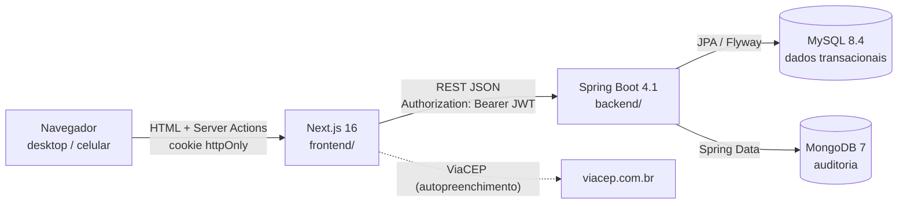
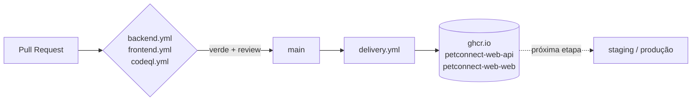

# Arquitetura — PetConnect Web

## Visão geral



### Por que dois bancos

| MySQL | MongoDB |
|---|---|
| Clientes, pets, agendamentos, vendas, estoque e financeiro | Trilha de auditoria (`auditoria`) |
| Relacional, com FK, `CHECK` e transações: uma venda baixa estoque e lança no financeiro de forma atômica | Append-only, esquema flexível (`detalhes` muda por ação), volume cresce mais rápido que o dos dados de negócio |
| Schema versionado (Flyway `V<n>__*.sql`) | Sem migration: coleção criada pela aplicação |

Candidatos futuros para o Mongo: notificações, histórico de alterações campo a campo e cache de relatórios. Dados de negócio **não** vão para o Mongo.

## Backend (`backend/`)

**Monólito modular**, no mesmo padrão do `PetConnect-API`. Cada contexto fica em um pacote com as camadas:

```
br.com.tecnodreamer.petconnect
├── shared/        config (security, OpenAPI, clock) · error (RFC 9457) · audit (Mongo) · validation (CPF/CEP/telefone) · web
├── auth/          login → JWT; limitador de tentativas
├── usuario/       usuário, papel, bootstrap do primeiro ADMIN
├── endereco/      entidade compartilhada (cliente, funcionário, fornecedor)
└── cliente/       domain · application · infrastructure · web
```

Convenções:

- `domain`: entidades JPA sem setters públicos, com mudança de estado por métodos de intenção (`inativar()`, `atualizarDados(...)`).
- `application`: serviços `@Transactional`. Regras de negócio e auditoria ficam aqui.
- `infrastructure`: repositórios Spring Data.
- `web`: controllers e DTOs (`record`) com Bean Validation. A entidade nunca é exposta na API.
- Erros: `NotFoundException` vira 404 e `ConflictException` vira 409. Validação devolve 400 com `errors: {campo: mensagem}`. Tudo em `application/problem+json`.
- Paginação: `PageResponse<T>` (`content`, `page`, `size`, `totalElements`, `totalPages`).
- Exclusão de cadastros é **lógica** (`ativo = false`), para preservar o histórico de vendas e atendimentos.

### Segurança

- **Stateless**: `POST /api/v1/auth/login` devolve um JWT HS256 assinado pela própria API (`JWT_SECRET` com pelo menos 32 bytes). O papel vai na claim `roles` e vira `ROLE_ADMIN`, `ROLE_VENDAS` ou `ROLE_SERVICO`.
- Autorização por método (`@PreAuthorize`). Leitura de clientes: qualquer autenticado. Escrita: ADMIN e VENDAS.
- Senhas com BCrypt (custo 12). No login, usuário inexistente e senha errada dão a mesma resposta e o mesmo tempo (compara com um hash falso).
- Bloqueio após 5 falhas seguidas por 15 minutos, por login (em memória; com mais de uma réplica, trocar por Redis).
- O primeiro ADMIN vem de variáveis de ambiente. Nenhuma senha fica em script ou código.
- No perfil `prod`, o Swagger fica desligado, stack traces nunca são expostos e não há valor padrão para segredos.

### Testes

| Tipo | Sufixo | Plugin | Infra |
|---|---|---|---|
| Unitário | `*Test` | surefire | nenhuma (Mockito) |
| Integração | `*IT` | failsafe | Testcontainers: MySQL 8.4 + Mongo 7 reais, contexto compartilhado (`IntegrationTest`) |

`./mvnw verify` roda os dois e gera cobertura JaCoCo combinada em `target/site/jacoco`.

## Frontend (`frontend/`)

Next.js 16 com App Router. Pontos que mudaram em relação a versões anteriores: `middleware.ts` virou **`proxy.ts`**, e `params`/`searchParams`/`cookies()` são assíncronos. A documentação da versão instalada fica em `node_modules/next/dist/docs/`.

### Padrão BFF (backend-for-frontend)

1. O formulário de login chama a Server Action `entrar`, que chama a API no servidor e grava o JWT em um cookie **httpOnly** (`pc_session`, `SameSite=Lax`, `Secure` em produção).
2. Server Components e Server Actions usam `apiFetch()` (`src/lib/api.ts`, `server-only`), que lê o cookie e envia `Authorization: Bearer`.
3. O navegador nunca tem acesso ao token. Por isso a API não precisa de CORS aberto para o front, e um XSS não consegue roubar a sessão.
4. `src/proxy.ts` faz a checagem **otimista** (decodifica o JWT sem verificar a assinatura) só para redirecionar. Quem garante a segurança é a API.

```
src/
├── proxy.ts                 redireciona quem não tem sessão
├── app/
│   ├── login/               tela pública
│   ├── (app)/               área autenticada (layout com AppShell responsivo)
│   │   ├── dashboard/
│   │   └── clientes/        lista · novo · [id]
│   └── actions/             Server Actions (auth, clientes)
├── components/              AppShell, formulários, campos acessíveis
└── lib/                     api (server-only), session, jwt, schemas Zod, máscaras
```

Convenções:

- Leitura em **Server Components**. Escrita em **Server Actions** com `useActionState`, com validação Zod no servidor espelhando a da API. O erro 400 da API é mapeado de volta para os campos.
- Responsivo mobile-first: tabela no `md+` e cartões no celular. A barra lateral vira gaveta no celular.
- Tokens de cor em `globals.css` (OKLCH, com modo escuro automático). Componentes base (`campo`, `botao-*`, `cartao`) são `@utility` do Tailwind 4.
- Os testes (`*.test.ts[x]`) ficam ao lado do código. O ambiente padrão é `node`; testes de componente usam `// @vitest-environment jsdom`.

## Entrega



Imagens: API em JRE 21 com camadas extraídas, usuário não-root e healthcheck de readiness. Web em Next `standalone` sobre Node 24 alpine, com usuário não-root.
