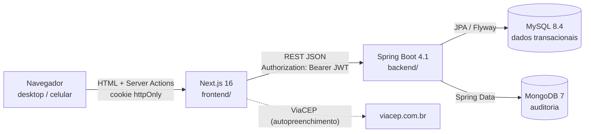
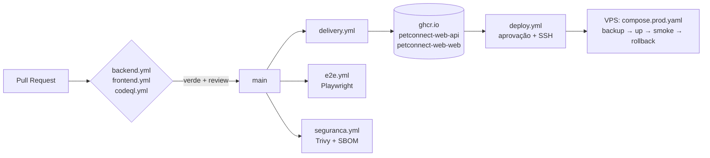

# Arquitetura — PetConnect Web

## Visão geral



### Por que dois bancos

| MySQL | MongoDB |
|---|---|
| Clientes, pets, agendamentos, vendas, estoque e financeiro | Trilha de auditoria (`auditoria`) |
| Relacional, com FK, `CHECK` e transações: uma venda baixa estoque e lança no financeiro de forma atômica | Append-only, esquema flexível (`detalhes` muda por ação), volume cresce mais rápido que o dos dados de negócio |
| Schema versionado (Flyway `V<n>__*.sql`) | Sem migration: coleção criada pela aplicação |

Candidatos futuros para o Mongo: notificações, histórico de alterações campo a campo e cache de relatórios. Dados de negócio **não** vão para o Mongo.

## Backend (`backend/`)

**Monólito modular**, no mesmo padrão do `PetConnect-API`. Cada contexto fica em um pacote com as camadas:

```
br.com.tecnodreamer.petconnect
├── shared/        config (security, OpenAPI, clock) · error (RFC 9457) · audit (Mongo) · validation (CPF/CEP/telefone) · web
├── auth/          login → JWT; limitador de tentativas
├── usuario/       usuário, papel, bootstrap do primeiro ADMIN
├── endereco/      entidade compartilhada (cliente, funcionário, fornecedor)
├── cliente/       domain · application · infrastructure · web
├── pet/           pets, catálogos (espécie/raça/vacina), carteira de vacinação, consultas, foto
├── servico/       catálogo de serviços e preço por porte (CRUD de ADMIN)
├── agendamento/   agenda, conflito de horário, máquina de estados, serviço realizado
├── funcionario/   perfil operacional 1:1 do usuário (CRUD de ADMIN; disponível = conta ativa)
├── produto/       produtos, categorias (leitura), EstoqueService (único ponto que altera saldo), custo médio
├── fornecedor/    fornecedores com CNPJ validado e endereço
├── compra/        pedido de compra, recebimento (entrada no estoque) e cancelamento
├── venda/         PDV: prévia, venda idempotente, cancelamento com estorno, resumo do dia
├── financeiro/    FinanceiroService (único que grava lançamentos), caixa, contas a pagar, fluxo, backfill
├── relatorio/     somente leitura: agregações em SQL (NamedParameterJdbcTemplate), CSV e auditoria da exportação
└── migracao/      ferramenta OFFLINE de migração do PHP: runner condicional, conexão legado só leitura, migradores, mapa, conferências
```

### Agendamentos

- **Máquina de estados** centralizada em `StatusAgendamento`: transições permitidas, estados terminais, quem ocupa a agenda. O status só muda por `POST /api/v1/agendamentos/{id}/status`. O papel exigido depende da transição e é conferido no serviço.
- **Preço** calculado sempre no backend: o preço do porte tem precedência, e pet sem porte usa o padrão (nunca assume Pequeno). O valor fica **congelado** em `total_estimado`.
- **Conflito** com intervalo semiaberto `[início, fim)`, pela duração atual do serviço, por pet e por funcionário (quando houver). A linha do pet fica travada com `SELECT … FOR UPDATE` durante a criação ou edição, para duas requisições simultâneas não furarem a verificação.
- **Conclusão** cria um `servico_realizado`. Se o serviço for "Vacinação" (nome exato), chama `CarteiraVacinaService.registrar` na mesma transação: se a dose falhar, nada é concluído.

Convenções:

- `domain`: entidades JPA sem setters públicos, com mudança de estado por métodos de intenção (`inativar()`, `atualizarDados(...)`).
- `application`: serviços `@Transactional`. Regras de negócio e auditoria ficam aqui.
- `infrastructure`: repositórios Spring Data.
- `web`: controllers e DTOs (`record`) com Bean Validation. A entidade nunca é exposta na API.
- Erros: `NotFoundException` vira 404 e `ConflictException` vira 409. Validação devolve 400 com `errors: {campo: mensagem}`. Tudo em `application/problem+json`.
- Paginação: `PageResponse<T>` (`content`, `page`, `size`, `totalElements`, `totalPages`).
- Exclusão de cadastros é **lógica** (`ativo = false`), para preservar o histórico de vendas e atendimentos.
- Regra de negócio violada num campo do request (tutor inexistente, data futura...) lança `CampoInvalidoException` e vira 400 com `errors: {campo: msg}`, no mesmo formato da Bean Validation.
- "Hoje" vem sempre do `Clock` injetado (fuso `America/Sao_Paulo`). Testes usam `Clock.fixed(...)`. Idade e status de vacina são calculados na leitura, nunca persistidos.

### Estoque e compras

- **Saldo nunca é editado direto**: o cadastro de produto não aceita quantidade (nasce com 0). Só `EstoqueService` altera `quantidade_estoque`, sempre com `SELECT … FOR UPDATE` no produto e gravando uma linha imutável em `movimentacao_estoque` (saldo anterior e resultante, usuário, origem). Saldo negativo é recusado (409), e o banco também tem `CHECK`.
- **Recebimento atômico**: `POST /compras/{id}/receber` trava a compra, trava os produtos **em ordem de id** (evita deadlock entre recebimentos simultâneos), dá uma `ENTRADA_COMPRA` por item e recalcula o **custo médio ponderado** (`BigDecimal`, 2 casas, `HALF_UP`; sem saldo anterior, usa o custo da compra). Qualquer falha desfaz tudo.
- **Compra**: `PEDIDO → RECEBIDO | CANCELADO` (`StatusCompra`); total calculado no backend a partir dos itens. Criar e cancelar não mexem no estoque. Compra criada não é editada.
- **Ajuste manual** (só ADMIN): delta ≠ 0 com motivo obrigatório; não altera o custo.
- Fornecedor com `PEDIDO` em aberto não pode ser desativado; fornecedor e produto inativos não entram em nova compra; busca rápida (para o PDV) só retorna produtos ativos, com prioridade para o código de barras exato.

### Vendas (PDV)

- **Preço, desconto, total e troco vêm do backend**: o request só traz `produtoId` e `quantidade`. O preço é o `preco_venda` lido com o produto travado e fica congelado em `item_venda`. Desconto em valor, menor que o subtotal; VENDAS tem teto (`petconnect.vendas.desconto-maximo-percentual-vendas`, padrão 10%); ADMIN não. Em dinheiro, o valor recebido é obrigatório e ≥ total.
- **Atomicidade e concorrência**: `VendaService.registrar` trava os produtos em ordem crescente de id (mesma ordem do recebimento de compra, sem deadlock), confere o saldo de todos antes de gravar (falta de qualquer item → 409 com `produtoId`, `disponivel`, `solicitado`) e dá a baixa pelo `EstoqueService.registrarSaidaVenda` (`SAIDA_VENDA` com quantidade negativa e `venda_id`).
- **Idempotência**: `POST /api/v1/vendas` exige `Idempotency-Key` (UUID), gravada com UNIQUE. A mesma chave do mesmo operador devolve a venda original com 200 e `Idempotent-Replayed: true`, sem nova baixa; em corrida, a UNIQUE derruba a segunda gravação e `RegistroVendaIdempotente` (fora da transação) devolve a primeira. Chave de outro operador → 409.
- **Cancelamento** (só ADMIN, até 7 dias, com motivo): trava a venda, estorna cada item com `ESTORNO_VENDA` (inclusive produto desativado) e registra quem/quando/por quê. A venda nunca é apagada nem editada.
- **Prévia** (`POST /vendas/previa`): mesmos cálculos sem gravar nem travar; o PDV mostra os números do backend e pede confirmação com o total dele.
- A venda ainda não gera `movimentacao_financeira` (etapa 06).

### Financeiro e caixa

- **Serviço central**: só `FinanceiroService` grava `movimentacao_financeira`. Venda, cancelamento, conclusão de serviço, pagamento de conta, sangria/suprimento e lançamentos manuais chamam o serviço **na mesma transação** do módulo de origem: se o lançamento falhar, tudo volta.
- **Unicidade**: cada lançamento tem `chave_origem` UNIQUE (`VENDA:91`, `SERVICO:7`...). Replay da venda não duplica; o manual usa `Idempotency-Key` (`MANUAL:uuid`) com o mesmo padrão da venda.
- **Imutável**: lançamento nunca é editado nem apagado. Correção é estorno (lançamento inverso com `estorno_de_id` UNIQUE). Só o manual é estornado direto; automáticos são corrigidos pelo módulo de origem (ex.: cancelar a venda).
- **Regime de caixa**: venda e serviço entram na hora; compra recebida vira conta a pagar e só sai no pagamento (integral, com lock). Cartão é reconhecido na operação (taxas e liquidação ficam fora).
- **Caixa por operador**: um ABERTO por usuário (coluna gerada + UNIQUE). Vender, concluir serviço, pagar conta, lançar manual e cancelar venda exigem o caixa aberto de quem opera (409 sem caixa). Esperado em dinheiro = fundo + Σ(entradas − saídas em dinheiro do caixa); sangria e suprimento já são lançamentos em dinheiro. Fechamento sob `FOR UPDATE`, com esperado/contado/diferença por forma, motivo obrigatório se houver diferença, e sem reabertura.
- **Ordem de locks**: produtos (ordem de id) → caixa; o fechamento trava só o caixa. A checagem "tem caixa?" é feita antes, sem lock, para falhar rápido.

### Fotos dos pets

- `FotoPetStorage` (interface) com a implementação `LocalFotoPetStorage` em disco: `petconnect.storage.pets` (env `PETS_STORAGE_DIR`). No Docker fica no volume `petconnect_uploads:/data/uploads`; nos testes, em `target/it-uploads`.
- O tipo é detectado pelos *magic bytes* (JPEG, PNG ou WebP; SVG e GIF recusados), com no máximo 5 MB. O nome interno é `UUID.ext`, e a chave é validada por regex e `normalize()` contra path traversal.
- A API expõe só `/api/v1/pets/{id}/foto`. O banco guarda só a chave em `pet.foto_url`. O navegador carrega a imagem por `/api/pets/{id}/foto` (route handler do Next que repassa com o token do cookie).
- A troca de foto apaga o arquivo antigo **depois do commit**.
- Para vários servidores, basta trocar a implementação da interface por um storage externo.

### Migração do legado (etapa 08)

- **Execução.** `MigracaoLegadoRunner` só existe com `petconnect.migracao.legado=true`. Não há endpoint nem tela.
- **Conexão com o legado.**
  - `LegadoConexao` é um Hikari `readOnly` com um usuário que só tem SELECT.
  - De propósito, não é um bean `DataSource`: um segundo DataSource no contexto desligaria a autoconfiguração do banco principal.
- **Migradores.** Há um `Migrador` por entidade, em ordem fixa por `@Order`.
  - O legado é lido em lotes por id (`id > :ultimo`), nunca por OFFSET.
  - Registros sem regra própria são gravados por `DestinoMigracao` (SQL simples).
  - Saldo, lançamento e foto passam pelos serviços de domínio: `EstoqueService`, `FinanceiroService` e `FotoPetService`.
- **Transações.**
  - Execução REAL: uma transação por lote. Uma falha interrompe as entidades seguintes, e a próxima execução retoma pelo `migracao_legado_mapa`.
  - DRY-RUN: tudo numa transação que termina em rollback.
  - O histórico em `migracao_legado_execucao` é gravado em transação própria (`REQUIRES_NEW`).
- **Auditoria.** `AuditoriaService.semAuditoriaPorRegistro` suprime os eventos por item, porque o MongoDB não participa do rollback. Só um `MIGRACAO_LEGADO_EXECUTADA` é gravado, e só na execução real.
- **Fechamento.** Depois dos dados rodam o `FinanceiroBackfill` (vendas e serviços) e o `MigracaoConferenciaService` (contagens, somas, estoque e duplicidade). Por fim, o relatório Markdown sem dados pessoais.

### Produção e operação (etapa 09)

Detalhes em [producao.md](producao.md) e [runbooks/](runbooks).

**Topologia e deploy**
- Uma VPS com `compose.prod.yaml`.
- O Caddy (HTTPS automático, HSTS) é o único exposto. Web, API e bancos ficam em redes internas; a API não é pública.
- Deploy por tag com `scripts/deploy.sh`: backup → pull → up → smoke → rollback automático.

**Correlação de requisições**
- O `proxy.ts` gera ou propaga o `X-Request-Id`; o `apiFetch` e a action de login o repassam.
- Na API, o `RequestIdFilter` põe o id no MDC (`requestId`) e o ecoa na resposta.

**Logs e métricas**
- Logs em JSON ECS no perfil prod; `MascaramentoLogs` mascara CPF, e-mail, telefone e tokens em qualquer texto do log.
- Actuator e `/actuator/prometheus` na porta 9090 (`management.server.port`), não publicada.

**Limite de login por IP**
- `LimitadorLogin`: 20 falhas em 5 min → 429 + `Retry-After`.
- É em memória, porque a produção roda uma única instância.
- O IP chega por `X-Forwarded-For` (Caddy → Next → API).

**LGPD**
- `ClientePrivacidadeService` faz exportação JSON e anonimização irreversível sem hard-delete (ver [runbooks/lgpd.md](runbooks/lgpd.md)).

### Relatórios

- **Somente leitura** (`@Transactional(readOnly = true)`): cada relatório é um `SELECT` agregado no MySQL; nenhuma entidade é carregada para somar em memória. `RelatorioCalculos` só faz as contas finais (ticket médio, percentuais, curva ABC, giro, cobertura, zerar dias sem movimento) com `BigDecimal` HALF_UP.
- **Período** obrigatório (`dataInicio`/`dataFim`, fim ≥ início, no máximo 366 dias), validado igual no back (`Periodo`) e no front (`erroPeriodo`).
- **Regras**: só vendas `CONCLUIDA` entram no faturamento (canceladas aparecem à parte); curva ABC pelo acumulado **antes** do produto (< 80% A, < 95% B, resto C); margem, valor de estoque e giro usam o **custo médio atual** (aviso explícito, sem custo histórico por item); despesas = saídas das categorias de despesa menos estornos, sem `CAIXA_%` (sangria/suprimento).
- **Permissões**: ADMIN vê os 9; VENDAS vê vendas, produtos mais vendidos e curva ABC (sem custo, margem, despesas, caixas ou contas); SERVICO não acessa. Barrado por URL no `SecurityConfig` e por `@PreAuthorize`.
- **CSV**: `GET /api/v1/relatorios/{tipo}/csv` com BOM UTF-8, `;`, vírgula decimal e datas dd/MM/aaaa (abre direto no Excel pt-BR); cada exportação gera `RELATORIO_EXPORTADO`. O navegador baixa por `/api/relatorios/[tipo]/csv` (route handler do Next que repassa o token do cookie).

### Segurança

- **JWT com revogação**: `POST /api/v1/auth/login` devolve um JWT HS256 (`JWT_SECRET` com pelo menos 32 bytes) com as claims `uid`, `roles` e `tv` (versão da credencial). A cada requisição, `UsuarioJwtAuthenticationConverter` confere no banco se o usuário existe, está ativo e tem o mesmo `token_version`. O papel usado na autorização é o **do banco**. A troca ou redefinição de senha, a mudança de papel e a (des)ativação incrementam `token_version`, o que derruba na hora todas as sessões abertas (401).
- Quando a API responde 401, o `apiFetch` do front redireciona para `/login?expirada=1`, e o `proxy.ts` apaga o cookie (sem isso, um cookie revogado entraria em loop entre login e painel).
- Rotas administrativas (`/api/v1/usuarios/**`, as escritas de serviços, funcionários, fornecedores e compras, o ajuste de estoque, a reativação de produto o cancelamento de venda todo `/api/v1/financeiro/**` e os relatórios de custo/financeiro; fornecedores, compras e vendas nem são lidos por SERVICO; listar todos os caixas é só ADMIN) também são barradas **por URL** no filtro. Assim, um papel sem permissão recebe 403 antes da validação do corpo.
- **Senha**: `PoliticaSenha` é a regra única (10–72 caracteres, maiúscula, minúscula, número, especial, diferente do username e do e-mail), usada na criação, troca, redefinição e no bootstrap.
- **Recuperação**: token de 32 bytes aleatórios, e só o SHA-256 vai para o banco. Vale 30 minutos, é de uso único, e um novo pedido invalida os anteriores. A resposta é sempre 202 e neutra. O limite, em memória, é de 3 pedidos por e-mail e 10 por IP a cada 30 minutos; o IP vem em `X-Forwarded-For`, repassado pelo Next. O e-mail sai por `EmailService`: SMTP configurável, com Mailpit no dev.
- **Último ADMIN**: não pode ser desativado nem rebaixado (lock `FOR UPDATE` nos ADMINs ativos). Nenhum ADMIN altera o próprio papel nem se desativa.
- Autorização por método (`@PreAuthorize`). Leitura de clientes: qualquer autenticado. Escrita: ADMIN e VENDAS.
- Senhas com BCrypt (custo 12). No login, usuário inexistente e senha errada dão a mesma resposta e o mesmo tempo (compara com um hash falso).
- Bloqueio após 5 falhas seguidas por 15 minutos, por login (em memória; com mais de uma réplica, trocar por Redis).
- O primeiro ADMIN vem de variáveis de ambiente. Nenhuma senha fica em script ou código.
- No perfil `prod`, o Swagger fica desligado, stack traces nunca são expostos e não há valor padrão para segredos.

### Testes

| Tipo | Sufixo | Plugin | Infra |
|---|---|---|---|
| Unitário | `*Test` | surefire | nenhuma (Mockito) |
| Integração | `*IT` | failsafe | Testcontainers: MySQL 8.4 + Mongo 7 reais, contexto compartilhado (`IntegrationTest`) |

`./mvnw verify` roda os dois e gera cobertura JaCoCo combinada em `target/site/jacoco`.

## Frontend (`frontend/`)

Next.js 16 com App Router. Pontos que mudaram em relação a versões anteriores: `middleware.ts` virou **`proxy.ts`**, e `params`/`searchParams`/`cookies()` são assíncronos. A documentação da versão instalada fica em `node_modules/next/dist/docs/`.

### Padrão BFF (backend-for-frontend)

1. O formulário de login chama a Server Action `entrar`, que chama a API no servidor e grava o JWT em um cookie **httpOnly** (`pc_session`, `SameSite=Lax`, `Secure` em produção).
2. Server Components e Server Actions usam `apiFetch()` (`src/lib/api.ts`, `server-only`), que lê o cookie e envia `Authorization: Bearer`.
3. O navegador nunca tem acesso ao token. Por isso a API não precisa de CORS aberto para o front, e um XSS não consegue roubar a sessão.
4. `src/proxy.ts` faz a checagem **otimista** (decodifica o JWT sem verificar a assinatura) só para redirecionar. Quem garante a segurança é a API.

```
src/
├── proxy.ts                 redireciona quem não tem sessão
├── app/
│   ├── login/               tela pública
│   ├── (app)/               área autenticada (layout com AppShell responsivo)
│   │   ├── dashboard/
│   │   ├── clientes/        lista · novo · [id] (com os pets do cliente)
│   │   ├── pets/            lista · novo (?clienteId=) · [id]?aba=dados|vacinas|consultas
│   │   ├── agendamentos/    agenda dia/semana (?data&modo) · novo (?petId=) · [id] (ações de status)
│   │   ├── servicos/        catálogo (edição só ADMIN)
│   │   ├── produtos/        lista (filtros, abaixo do mínimo) · novo · [id]?aba=dados|estoque (histórico e ajuste)
│   │   ├── fornecedores/    lista · novo · [id] (ADMIN/VENDAS; escrita só ADMIN)
│   │   ├── compras/         lista · nova (itens dinâmicos) · [id] (receber/cancelar, só ADMIN)
│   │   ├── pdv/             frente de caixa (leitor de código, carrinho em sessionStorage, prévia, finalização idempotente)
│   │   ├── vendas/          lista (padrão: hoje) · [id] (detalhe e cancelamento pelo ADMIN)
│   │   ├── caixa/           abrir, sangria/suprimento, fechar com conferência · [id] (histórico)
│   │   ├── financeiro/      fluxo e lançamentos · lancamentos/novo|[id] · contas-a-pagar (só ADMIN)
│   │   ├── relatorios/      hub (cards por papel) · [tipo]?dataInicio&dataFim (atalhos, barras em CSS + tabela, CSV)
│   │   ├── usuarios/        contas, papel, ativação e funcionário (só ADMIN)
│   │   └── perfil/          conta, dados de funcionário e troca de senha do próprio usuário
│   ├── (impressao)/         páginas autenticadas sem AppShell: comprovantes de venda e de fechamento de caixa (~80 mm) e relatórios em A4 (`relatorios/[tipo]/imprimir`)
│   ├── esqueci-senha/, redefinir-senha/   públicas (liberadas no proxy.ts)
│   ├── api/                 route handlers: foto do pet, busca de tutor, busca rápida de produto, download do CSV de relatórios
│   └── actions/             Server Actions (auth, clientes, pets)
├── components/              AppShell, formulários, campos acessíveis
└── lib/                     api (server-only), session, jwt, schemas Zod, máscaras
```

Convenções:

- Leitura em **Server Components**. Escrita em **Server Actions** com `useActionState`, com validação Zod no servidor espelhando a da API. O erro 400 da API é mapeado de volta para os campos.
- Responsivo mobile-first: tabela no `md+` e cartões no celular. A barra lateral vira gaveta no celular.
- Tokens de cor em `globals.css` (OKLCH, com modo escuro automático). Componentes base (`campo`, `botao-*`, `cartao`) são `@utility` do Tailwind 4.
- Os testes (`*.test.ts[x]`) ficam ao lado do código. O ambiente padrão é `node`; testes de componente usam `// @vitest-environment jsdom`.

## Entrega



Imagens: API em JRE 21 com camadas extraídas, usuário não-root e healthcheck de readiness. Web em Next `standalone` sobre Node 24 alpine, com usuário não-root.
