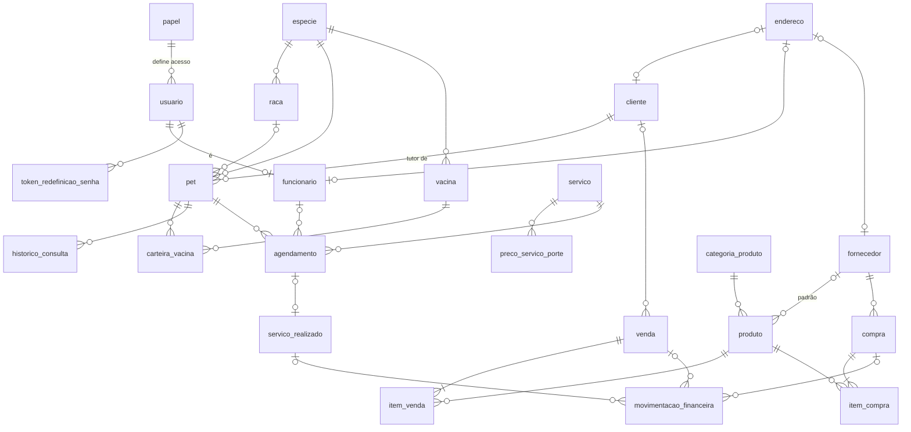

# Banco de dados — PetConnect Web

Fonte da verdade: [`backend/src/main/resources/db/migration`](../backend/src/main/resources/db/migration).

- `V1__schema_inicial.sql`: todas as tabelas.
- `V2__dados_referencia.sql`: catálogos (papéis, espécies, raças, categorias, serviços, preço por porte, vacinas).

Regra: **nunca editar uma migration já aplicada**. Mudança de schema entra sempre como uma `V<n+1>__descricao.sql` nova.

## O que mudou em relação ao banco legado (`pet_e_pet_db`)

| Problema no legado | Como ficou |
|---|---|
| `cep`, `rua`, `bairro`, `numero`, `complemento` repetidos em `cliente`, `funcionario` e `fornecedor` (e sem cidade) | Tabela **`endereco`** (com `cidade` e `uf`). Os donos têm `endereco_id` (FK única, `ON DELETE SET NULL`) |
| `super_usuario` duplicava a informação de `papel` | Removida. O nível de acesso vem só de `usuario.papel_id` |
| `usuario.token_senha` / `token_expira` soltos no usuário | Tabela `token_redefinicao_senha`, que guarda **só o SHA-256** do token |
| `pet.vacinado` podia contradizer a carteira | Removida. É derivada de `carteira_vacina` |
| `carteira_vacina.nome_vacina` em texto livre | FK `vacina_id` para o catálogo `vacina` (mais `lote`) |
| `item_venda.subtotal` / `item_compra.subtotal` digitados | **Colunas geradas** (`quantidade * preço`) |
| `movimentacao_financeira.referencia_id` polimórfico, sem FK | `venda_id`, `compra_id`, `servico_realizado_id` com FK e `CHECK` de no máximo uma origem |
| CPF, CNPJ, CEP e telefone com máscara em formatos variados | Só dígitos (`CHAR(11)`, `CHAR(14)`, `CHAR(8)`). A máscara é aplicada no front |
| `ENUM` do MySQL (`'Pequeno'`, `'cartao_credito'`...) | `VARCHAR` + `CHECK` em MAIÚSCULAS (`PEQUENO`, `CARTAO_CREDITO`), mapeados com `@Enumerated(STRING)` |
| `INT` / `TIMESTAMP` | `BIGINT` / `DATETIME(6)` (sem o limite de 2038) |
| Duplicatas em catálogos (ex.: "Golden Retriever" duas vezes) | `UNIQUE (especie_id, nome)` em `raca` e `vacina` |

## Modelo (resumo)

## MongoDB

| Coleção | Documento | Índices |
|---|---|---|
| `auditoria` | `{ocorridoEm, usuario, acao, entidade, entidadeId, detalhes}` | `ocorridoEm`, `usuario`, `entidade` |

Ações registradas hoje: `LOGIN`, `LOGIN_FALHOU`, `CRIAR`/`ATUALIZAR`/`INATIVAR` de cliente. Consulta (ADMIN): `GET /api/v1/auditoria?entidade=cliente&entidadeId=1`.

## Migração dos dados legados (etapa futura)

Pontos de atenção já identificados no script do legado:

1. **Senhas**: o legado grava `SHA-256` puro, sem sal (ex.: `240be518…` é o hash de `admin123`). Esse hash **não pode ser migrado**. Os usuários migram sem senha válida e redefinem a senha pelo fluxo de "esqueci a senha".
2. **Endereços**: cada linha de `cliente`/`funcionario`/`fornecedor` com CEP gera uma linha em `endereco`. Cidade não existe no legado e precisa ser preenchida via ViaCEP a partir do CEP.
3. **Enums**: converter para MAIÚSCULAS (`'Medio'` → `MEDIO`, `'cartao_credito'` → `CARTAO_CREDITO`).
4. **Carteira de vacina**: casar `nome_vacina` com `vacina.nome` por espécie. Nomes sem correspondência viram vacinas novas no catálogo.
5. **Documentos**: remover máscara e validar os dígitos do CPF. CPFs inválidos vão para `observacoes` e o campo fica nulo.
6. **Dados pessoais reais** aparecem no script de inserção versionado em `docs/legacy/`. Avaliar remover do histórico público (LGPD).
