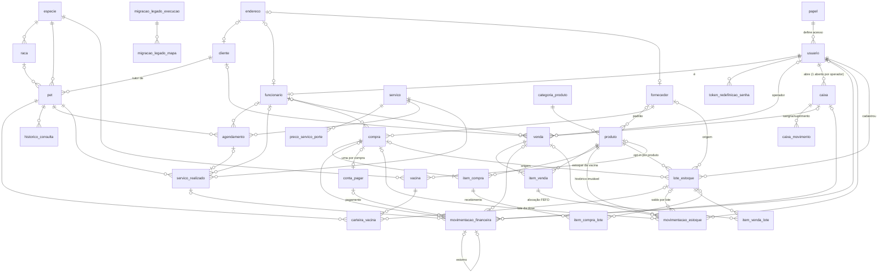

# Banco de dados — PetConnect Web

Fonte da verdade: [`backend/src/main/resources/db/migration`](../backend/src/main/resources/db/migration).

- `V1__schema_inicial.sql`: todas as tabelas.
- `V2__dados_referencia.sql`: catálogos (papéis, espécies, raças, categorias, serviços, preço por porte, vacinas).
- `V12__consumo_clinico_vacina.sql`: opção A da operação clínica (etapa 04 de lotes). **Aditiva**: `vacina.produto_id` (FK nula: o produto de estoque da vacina), `carteira_vacina.lote_id` (FK nula: o lote físico usado na dose) e o CHECK de tipo de `movimentacao_estoque` passa a aceitar `CONSUMO_CLINICO`. Vacina sem produto e lançamento sem lote seguem como antes. Ver [implementacao/04_TELAS_ALERTAS.md](implementacao/04_TELAS_ALERTAS.md) §5.
- `V11__lotes_estoque.sql`: núcleo de lote e validade (etapa 02 do plano de lotes; contrato em [implementacao/01_DECISOES_LOTES.md](implementacao/01_DECISOES_LOTES.md)). **Aditiva**: `produto` ganha `controla_lote`, `permite_sem_validade` (ambos FALSE) e `dias_bloqueio_validade` (nulo = margem global); tabela `lote_estoque` (UNIQUE `produto_id + codigo_lote`, saldo materializado ≥ 0, `validade DATE`, status DISPONIVEL/BLOQUEADO, custo da primeira entrada, índice FEFO `produto_id, status, validade, id`); `movimentacao_estoque` ganha `lote_id`, `lote_saldo_anterior`, `lote_saldo_resultante` e `operacao_id` (CHECK de coerência: lote e saldos andam juntos e a conta fecha) e o CHECK de tipo aceita `PERDA`, `VENCIMENTO` e `REGULARIZACAO_LOTE`; tabelas `item_venda_lote` (alocação FEFO da venda) e `item_compra_lote` (lotes do recebimento). Nenhuma linha existente muda e nenhum lote ou validade é inventado. Rollback: [implementacao/02_DOMINIO_E_BANCO.md](implementacao/02_DOMINIO_E_BANCO.md).
- `V10__migracao_legado.sql`: controle da migração do PHP (etapa 08). `migracao_legado_execucao` guarda o histórico (modo DRY_RUN/REAL, status, totais, mensagem sem dado pessoal). `migracao_legado_mapa` guarda entidade, id legado, id novo, situação MIGRADO/AJUSTADO/IGNORADO e códigos de motivo, com UNIQUE (entidade, id_legado), que é a base da idempotência. O backfill de contas a pagar ignora compras que estão nesse mapa.
- `V9__indices_relatorios.sql`: índices para os relatórios: `servico_realizado (data_servico)` e `conta_pagar (status, paga_em)`. Os demais filtros por período já tinham índice (V6–V8).
- `V8__financeiro_caixa_contas.sql`: tabelas `caixa` (um ABERTO por usuário via coluna gerada `usuario_aberto_id` + UNIQUE; esperado/contado/diferença por forma gravados no fechamento), `caixa_movimento` (sangria/suprimento) e `conta_pagar` (uma por compra, pagamento integral). `venda.caixa_id`. Em `movimentacao_financeira`: `forma_pagamento`, `usuario_id`, `caixa_id`, `conta_pagar_id`, `estorno_de_id` (UNIQUE: um estorno por lançamento), `chave_origem` (UNIQUE: `VENDA:id`, `VENDA_ESTORNO:id`, `SERVICO:id`, `CONTA_PAGAR:id`, `MANUAL:uuid`, `MANUAL_ESTORNO:id`, `CAIXA_SANGRIA:id`, `CAIXA_SUPRIMENTO:id`) e `motivo_estorno`, com índices por tipo/categoria/forma/data, caixa e origem. Sem backfill na migration: o histórico é gerado por `FinanceiroBackfillRunner` (`--petconnect.financeiro.backfill=true`, idempotente).
- `V7__vendas_status_idempotencia.sql`: `venda` ganha `status` (CONCLUIDA/CANCELADA), `usuario_id` (operador), `valor_recebido` (troco), `chave_idempotencia` (UNIQUE), `cancelada_em`, `cancelada_por` e `motivo_cancelamento`, com CHECKs de status, valores (`valor_total > 0`) e coerência do cancelamento; índices por status/data, cliente/data e pagamento/data. Recria `chk_mov_estoque_tipo` aceitando `ESTORNO_VENDA` (sem editar a V6). `data_venda`/`cancelada_em` guardam horário local de São Paulo, como a agenda.
- `V6__movimentacao_estoque_indices.sql`: tabela `movimentacao_estoque` (histórico imutável: `tipo` ENTRADA_COMPRA/SAIDA_VENDA/AJUSTE, `quantidade` ≠ 0, `saldo_anterior`, `saldo_resultante` ≥ 0, `compra_id`/`venda_id` de origem, `usuario_id` obrigatório, `motivo`, `created_at DATETIME(6)`) e índices de produto (categoria/ativo, ativo/estoque), fornecedor (ativo/nome) e compra (status/data, fornecedor/status). `compra_id` usa o índice automático da FK.
- `V5__seguranca_usuarios_funcionarios.sql`: `usuario.token_version` (revogação de sessão) e índices para ADMINs ativos, funcionário por nome e tokens pendentes por usuário. `token_redefinicao_senha (expira_em, usado_em)` fica para quando existir um job de limpeza.
- `V4__indices_agendamentos.sql`: índices compostos para conflito por pet e por funcionário, e filtros por status e por serviço no período, além do histórico de `servico_realizado`. `servico (ativo, nome)` ficou de fora: o catálogo é pequeno e já tem `UNIQUE (nome)`.
- `V3__indices_modulo_pets.sql`: índices compostos para pets por tutor, carteira por pet/data e consultas por pet/data. Não duplica os `UNIQUE (especie_id, nome)` que já atendem raça e vacina.

Regra: **nunca editar uma migration já aplicada**. Mudança de schema entra sempre como uma `V<n+1>__descricao.sql` nova.

## O que mudou em relação ao banco legado (`pet_e_pet_db`)

| Problema no legado | Como ficou |
|---|---|
| `cep`, `rua`, `bairro`, `numero`, `complemento` repetidos em `cliente`, `funcionario` e `fornecedor` (e sem cidade) | Tabela **`endereco`** (com `cidade` e `uf`). Os donos têm `endereco_id` (FK única, `ON DELETE SET NULL`) |
| `super_usuario` duplicava a informação de `papel` | Removida. O nível de acesso vem só de `usuario.papel_id` |
| `usuario.token_senha` / `token_expira` soltos no usuário | Tabela `token_redefinicao_senha`, que guarda **só o SHA-256** do token |
| `pet.vacinado` podia contradizer a carteira | Removida. É derivada de `carteira_vacina` |
| `carteira_vacina.nome_vacina` em texto livre | FK `vacina_id` para o catálogo `vacina` (mais `lote`) |
| `item_venda.subtotal` / `item_compra.subtotal` digitados | **Colunas geradas** (`quantidade * preço`) |
| `movimentacao_financeira.referencia_id` polimórfico, sem FK | `venda_id`, `compra_id`, `servico_realizado_id` com FK e `CHECK` de no máximo uma origem |
| CPF, CNPJ, CEP e telefone com máscara em formatos variados | Só dígitos (`CHAR(11)`, `CHAR(14)`, `CHAR(8)`). A máscara é aplicada no front |
| `ENUM` do MySQL (`'Pequeno'`, `'cartao_credito'`...) | `VARCHAR` + `CHECK` em MAIÚSCULAS (`PEQUENO`, `CARTAO_CREDITO`), mapeados com `@Enumerated(STRING)` |
| `INT` / `TIMESTAMP` | `BIGINT` / `DATETIME(6)` (sem o limite de 2038) |
| Duplicatas em catálogos (ex.: "Golden Retriever" duas vezes) | `UNIQUE (especie_id, nome)` em `raca` e `vacina` |

## Modelo (resumo)

O diagrama cobre as **33 tabelas** (os atributos estão no [dicionário de dados](dicionario-de-dados.md), gerado do banco real). Os grupos:
acesso, pessoas e endereço, pets, serviços e agenda, produtos/estoque/compras, vendas, financeiro/caixa e migração do legado.

## MongoDB

| Coleção | Documento | Índices |
|---|---|---|
| `auditoria` | `{ocorridoEm, usuario, acao, entidade, entidadeId, detalhes}` | `ocorridoEm`, `usuario`, `entidade` |

Ações registradas hoje:
- `LOGIN`, `LOGIN_FALHOU`;
- `CRIAR`/`ATUALIZAR`/`INATIVAR` de cliente;
- de pet (`entidade = "pet"`): `PET_CRIADO`, `PET_ATUALIZADO`, `PET_DESATIVADO`, `PET_FOTO_ATUALIZADA`, `VACINA_PET_REGISTRADA`, `VACINA_PET_REMOVIDA`, `CONSULTA_PET_REGISTRADA`.

- de serviço: `SERVICO_CRIADO`, `SERVICO_ATUALIZADO`, `SERVICO_DESATIVADO`;
- de agendamento: `AGENDAMENTO_CRIADO`, `AGENDAMENTO_ATUALIZADO`, `AGENDAMENTO_STATUS_ALTERADO` (confirmar/iniciar), `AGENDAMENTO_CANCELADO`, `AGENDAMENTO_NAO_COMPARECEU`, `AGENDAMENTO_CONCLUIDO`, sempre com `statusAnterior` e `statusNovo`.

- de usuários e funcionários: `USUARIO_CRIADO`, `USUARIO_ATUALIZADO`, `USUARIO_PAPEL_ALTERADO` (com papel anterior e novo), `USUARIO_DESATIVADO`, `USUARIO_ATIVADO`, `FUNCIONARIO_CRIADO`, `FUNCIONARIO_ATUALIZADO`, `PERFIL_ATUALIZADO`, `PERFIL_FUNCIONARIO_ATUALIZADO`, `SENHA_ALTERADA`, `REDEFINICAO_SENHA_SOLICITADA`, `SENHA_REDEFINIDA`. Nenhum desses eventos guarda senha, hash, token, JWT ou e-mail informado.

- de estoque (etapa 04): `PRODUTO_CRIADO`, `PRODUTO_ATUALIZADO`, `PRODUTO_DESATIVADO` (com o saldo no momento), `PRODUTO_ATIVADO`, `ESTOQUE_AJUSTADO` (quantidade, saldo anterior/resultante e motivo), `FORNECEDOR_CRIADO`, `FORNECEDOR_ATUALIZADO`, `FORNECEDOR_DESATIVADO`, `FORNECEDOR_ATIVADO`, `COMPRA_CRIADA`, `COMPRA_RECEBIDA`, `COMPRA_CANCELADA` (com motivo).
- de vendas (etapa 05): `VENDA_REALIZADA` (quantidade de itens, total, desconto, forma de pagamento, id do cliente) e `VENDA_CANCELADA` (motivo e total). O replay idempotente não gera evento.
- de financeiro (etapa 06): `LANCAMENTO_CRIADO` (todo lançamento, inclusive os automáticos, com tipo, categoria, valor, forma, origem e caixa), `LANCAMENTO_ESTORNADO`, `CONTA_PAGAR_CRIADA`, `CONTA_PAGA`, `CAIXA_ABERTO`, `CAIXA_SUPRIMENTO`, `CAIXA_SANGRIA`, `CAIXA_FECHADO` (esperado, contado e diferença). Replay idempotente não audita de novo.
- de relatórios (etapa 07): `RELATORIO_EXPORTADO` (entidade `relatorio`, id = tipo; detalhes: período e número de linhas). Visualizar relatório não é auditado.
- de privacidade (etapa 09): `CLIENTE_DADOS_EXPORTADOS` (sem detalhes) e `CLIENTE_ANONIMIZADO` (só o motivo informado pelo ADMIN).
- de migração (etapa 08): `MIGRACAO_LEGADO_EXECUTADA`, um evento por execução REAL, só com contagens. O dry-run não audita. Durante a migração, a auditoria por registro dos serviços de domínio (ajuste de estoque, lançamento, foto) é suprimida.

Leituras não são auditadas. Token, senha e bytes de imagem nunca vão para a auditoria. Consulta (ADMIN): `GET /api/v1/auditoria?entidade=cliente&entidadeId=1`.

## Migração dos dados legados (etapa 08)

Runbook: [migracao-legado.md](migracao-legado.md). Principais decisões:

1. **Senhas.** O SHA-256 sem sal do legado não é lido nem migrado.
   - Cada usuário recebe o BCrypt de um segredo aleatório descartado e entra pelo "esqueci a senha".
   - Usuário sem e-mail utilizável fica inativo, com o e-mail técnico `legado-<id>@migracao.invalid` (a coluna é NOT NULL/UNIQUE).
   - `super_usuario` vira ADMIN. Username que colide com o ADMIN do bootstrap vira `<nome>_legado`.
2. **Endereços.** Viram linhas em `endereco` quando há CEP válido e rua.
   - A cidade não existe no legado: vem do ViaCEP, se habilitado; senão fica "Não informada".
   - A UF vem do campo `estado` (sigla ou nome); desconhecida, fica "NI".
   - Ambos os casos geram pendência.
3. **Documentos.**
   - CPF de cliente inválido ou repetido fica NULL, com observação no cadastro (sem o número).
   - CPF de funcionário e CNPJ de fornecedor são NOT NULL: se inválidos, o registro é **ignorado**.
   - O telefone do cliente é NOT NULL/UNIQUE: inválido ou repetido também faz o cliente ser ignorado.
4. **Enums e categorias.** Usam tabela de conversão explícita (`ConversorLegado`); valor desconhecido vira o padrão documentado e gera pendência.
5. **Catálogos.** Casam pelo nome normalizado (sem acento/caixa; "Cachorro" = "Cão"); sem correspondência, são criados.
6. **Estoque.** O produto nasce com saldo 0, e o saldo legado entra num único AJUSTE pelo `EstoqueService`, com o usuário técnico inativo `migracao.legado`. Saldo negativo vira 0.
7. **Vendas e compras históricas.**
   - Não geram movimento de estoque.
   - A venda entra CONCLUIDA, com chave `LEGADO:<id>` e sem caixa.
   - A compra não gera conta a pagar.
8. **Financeiro.**
   - Os lançamentos de venda e serviço são regenerados pelo backfill; os do legado são ignorados.
   - Os demais entram pelo `FinanceiroService`, com `chave_origem = 'LEGADO:<id>'`.
9. **Fotos.** São resolvidas dentro de `fotos-dir`, sem path traversal, e validadas pelo `FotoPetService`.
10. **Testes.** Usam só a fixture sintética de `backend/src/test/resources/legacy/`. O esquema de teste usa VARCHAR no lugar de ENUM para simular dado sujo.

## Retenção (etapa 09)

- **Auditoria:** sem TTL. É prova das operações financeiras e de acesso, guardada pelo prazo fiscal mínimo de 5 anos, com expurgo anual manual ([runbooks/lgpd.md](runbooks/lgpd.md)).
- **Anonimização de cliente:** `UPDATE`s, sem `DELETE`:
  - nome `Cliente anonimizado #id`;
  - CPF, e-mail, nascimento e observações NULL;
  - telefone marcador `0` + id (11 dígitos);
  - endereço desvinculado e limpo;
  - observações dos pets NULL.
- **Backups:** cifrados. Retenção de 7 diários, 4 semanais e 6 mensais.
